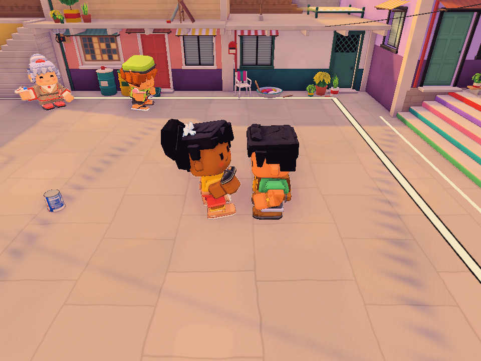

# Four-round halftime, October 21

The owner corrected the latest symptom: no replay appears, rather than
HIGHLIGHT UNAVAILABLE. The failing surface is the Unity Editor.

## Live evidence and decision

A passive capture of the actual Eskinita match at 2026-10-21 12:33:44 UTC records
round 2 of 4 opening an ordinary break: Active true, IsHalftime false and ClipId 0,
despite retained clips 9, 7 and 4. Live evaluation confirms the old minimum is six
and IsMiddleBreak(2,4) is false. This path never attempts a replay or shows its
fallback message. The temporary observer was removed without changing gameplay.

Three other actual retained clips rendered all 58 to 60 field frames in the live
world, with setup taking 0.042 to 0.054 seconds. That is separate evidence from
the original LagoonCove recorded-field failure and does not establish complete
standalone playback of its saved older clips.

The owner explicitly approved including four-round matches. The default minimum
is now four. The host nominates a complete highlight after round two; the shared
ten-second halftime package still ends with standings and advances to round three.
Payo keeps its existing minimum of two, and the final round cannot start halftime.
No clip schema, transport payload, scoring or playable-build files changed.

## Validation

The focused native run exercises the normal MatchDirector.BeginIntermission host
path with an actual retained catch in a four-round match. It must nominate and
draw that clip, show standings, advance once at the shared end and finish round
four without another halftime. The existing eight-round deadline/fallback check
also covers the four-, six-, eight- and final-round predicates.

Run output: Logs/halftime-followup-1021/four-round-fixed.xml and .log.
Unity 6000.5.8f1 with D3D11 graphics records two passed, zero failed and zero
skipped in fresh XML. Both normal-host four-round playback and the existing
eight-round shared-deadline control pass. The actual rendered four-round
highlight below was inspected. The guarded run ended with exit 0 and restored
one shared Editor input preference; the new named profile had no existing files.

No packaged player or new actual host/joiner acceptance is claimed. Concurrent
Nemu edits are outside this change. The separate saved-clip art reconstruction
failures recorded in the Blindfold report remain open.

