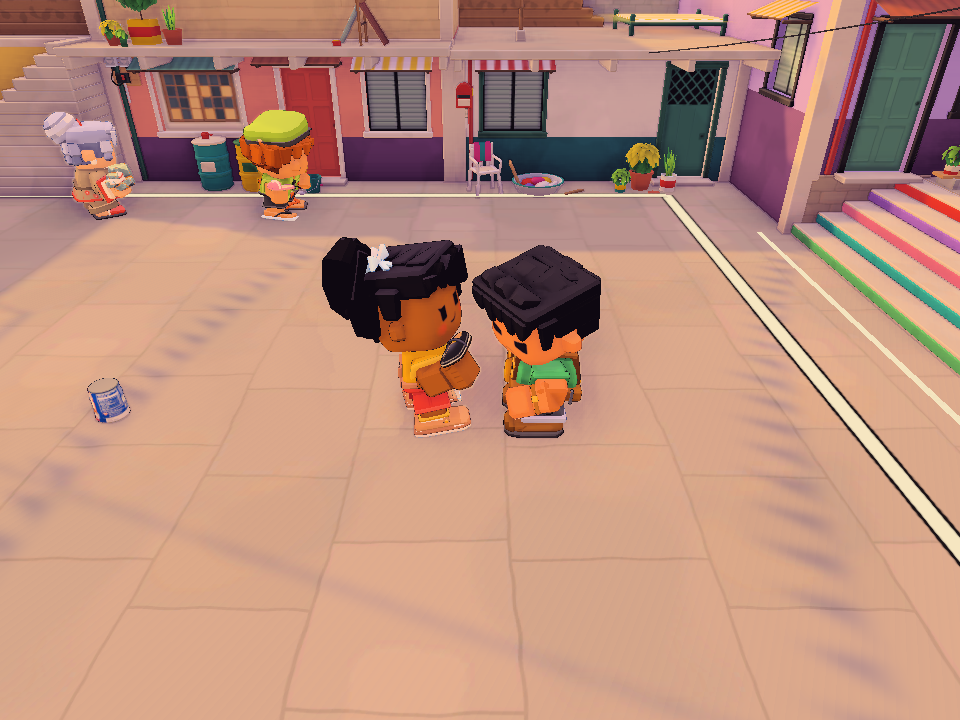

# Actual halftime Blindfold playback failure, October 21

The owner retested after 490e628e8 and still saw HIGHLIGHT UNAVAILABLE at the
LagoonCove round-five break. The previous timing correction and four focused
tests did not establish that this match's recorded effects could be drawn.
The earlier statement that the feature worked was broader than the evidence.

## Actual-match evidence

Read-only inspection of the running network host found three retained clips,
no archive LastSkip, and ReducedUiMotion disabled. Its Editor log identifies
490e628e8 and records two failures: `[Replay] Recorded view failed: Unsupported
recorded field`. Saved canonical clips 42, 43 and 44 are LagoonCove footage,
each 3.400024 seconds, containing WorldEffectSnapshot.Kind.Blindfold (19).
The saved later clips share the offending field; the screenshot's round-four
clip had already rotated out of the three-clip archive.

Constructing RecordedFieldView with an actual captured Blindfold field reproduced
`ArgumentException: Unsupported recorded field` in the native Editor. This
directly connects accepted recorded footage with the rendering failure.
The decoder already accepts this field, but RecordedFieldView had no branch for it.
Logs and actual clip bytes are retained under Logs/halftime-live-1021.

The owner log also contains incomplete-pose and invalid-pose-time local recording
warnings. Those are preserved; this investigation has not established them as
the cause of the halftime rendering exception or claimed to fix them.

## Correction and validation work

Add a playback-only Blindfold visual using its existing authored mesh, material,
pose, fade and smoke. Its component stays disabled and never uses Place, live
registration, trigger updates or cast audio. Sample the recorded age explicitly;
the waiting flight pose supports seeking without advancing from live frame time.
RecordedFieldView accepts the existing Blindfold payload. No gameplay, balance,
wire format or protocol change.

Regression work checks the field's drawing, seek stability and absence from the
live ghost registry, then captures an actual catch while Blindfold is present and
draws its halftime package until standings. A separate explicit reproduction
accepts saved canonical footage through TUMP_REPLAY_CLIP, draws every recorded
field frame and saves the native contact image.

## First corrected native run

Fresh graphics XML contains six cases, five passed and one failed, none skipped:

- The actual Blindfold field renders and seeks without entering the live ghost
  registry, enabling a trigger or advancing the real ghost's clock.
- A newly recorded catch containing Blindfold plays through to standings without
  a drawing exception. This checks the complete halftime package beyond Ready.
- The three existing delayed-stamp, delayed-byte and missing-byte controls pass.
- The explicit saved-owner-clip-44 reproduction stops before drawing at the
  unchanged art identity guard: Player P4's recorded key is 841137D3..., while the
  current catalog model is 4FBB3BB5.... The original failure is retained in
  Logs/halftime-live-1021/fixed.xml. This run does not establish complete playback
  of that saved clip, and the guard is not relaxed to make it pass.

Clips 42 and 43 from the same match retain the current catalog's Dante key, while
44 has the different key. The clip-42 reproduction then stops at Missing recorded
art: Slipper P4, skin 3. Its generated Boulder geometry is absent from the static
catalog prefab. Neither saved-clip reproduction passes complete reconstruction;
both failures remain recorded and the art guards are unchanged. No assets changed.

## Generated prop history correction

The combined Blindfold/Boulder halftime regression exposed a separate recording
defect. The live loaded slipper contains BoulderStone children, but its retained
pose track contains only the original root. The archive reused the track when
the source root matched, even after generated geometry changed its hierarchy.

Track reuse now checks the stable transform sequence as well as source identity.
Changed topology creates a fresh track through the existing prop binding scan
and unsafe-window fence. This records the new geometry after sufficient fresh
history exists without mixing incompatible old poses. Slipper appearance,
affinity behavior and recorded-art identity guards are unchanged.

## Final native verification

Unity 6000.5.8f1, D3D11 graphics, named isolated profile halftime-live-1021:
Logs/halftime-live-1021/complete-fixed.xml records five passed, zero failed,
zero skipped. The combined catch contains the recorded Blindfold and generated
BoulderStone pose nodes, renders the highlight through standings without fallback,
and captures the image below. The field lifecycle/seek check and three existing
delayed-stamp, delayed-byte and missing-byte controls also pass. Compilation passes.
The terminal guarded run restored 72 existing profile files and one shared Editor
input preference. No test job remains active.

The inspected image is the controlled Eskinita halftime regression. It is not
the owner's LagoonCove screenshot or successful reconstruction of the saved
owner clips. Standalone saved-art reconstruction and fresh actual host/joiner
acceptance remain open. No packaged player was produced or tested.

