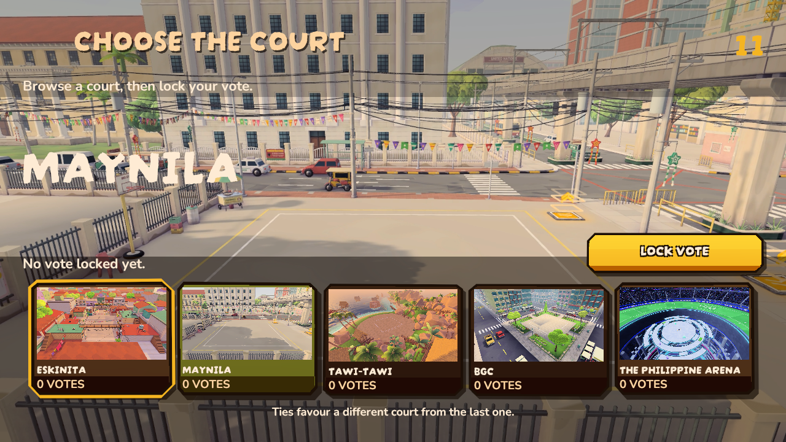

# Current map previews and five-map pool

Later October18 name-only correction: Eskinita is displayed as Tondo, Maynila as
Ermita and Tawi-Tawi as Sitangkai. The footage, map IDs/order and camera remain
unchanged. The names in the retained native captures below record the earlier
approved labels, before this correction.

October18 owner report: Host Game showed the old flat Eskinita although the
playable map is the stepped alley. Pulled ASTRAReworks fe1daa0d8 before editing.
Map selection already used recorded videos; stale footage and posters caused
the mismatch. The baseline audit found changed source fingerprints for every
registered map.

## Result

The active maps are Eskinita (`Eskinita`), Maynila (`IlalimNgTulay`), Tawi-Tawi
(`LagoonCove`), BGC (`Kanto`) and The Philippine Arena (`Arena`). Both registries,
rotation and enabled build scenes use this five-map pool. Bayan Plaza and
Sa Bubong retain their scenes/assets for rework but have no selection or direct
launch route. Old Eskinita remains vaulted with no active build/launch route.
Remaining scene and legacy IDs stay stable. Protocol172 fences the changed map
indices from older peers.

Regenerated all five videos and first-frame posters from the actual current
MapPreviewSurface camera. Replaced all five fallback cards with those exact
posters. Each H.264 clip is1920x1080,30fps,780frames and26seconds, with no encoder
warnings and a blob below100MiB. Existing20 media/card GUIDs are preserved.
The final capture dependencies match the primary checkout across6,986 paths.
[Media hashes/settings](raw/final-media.json), [source comparison](raw/final-source-comparison.json)
and [GUID preservation](raw/guid-preservation.json) retain the exact evidence.

Unity stripped the chalk material's emission keyword on leaving the first
recording session. The next import correctly rejected that Eskinita receipt.
Saved Unity's normalized material and recaptured Eskinita against those exact
bytes; all five source/media receipts now pass. The checker was not weakened.

The longer Arena name exposed card-label overflow. Widened the five vote/result
cards while preserving16:9 posters and the existing font floor; moved the vote
status and confirmation controls clear of the taller cards. Native720p/1080p
captures confirm full labels and unobstructed status. Inputs and ballot rules
are unchanged.

## Validation

Windows Unity6000.5.8f1 with D3D11, a physical isolated project, its own
company/product and a named profile. Guards restored their recorded profile
bytes/input preferences after each run. No Desktop build or user profile was
replaced.

- [EditMode22/22](raw/registry-fixed-tests.xml): approved names/IDs, exact enabled
  map scenes, retired direct-launch rejection, protocol and departed map ballots.
- [Media5/5](raw/media-tests.xml): every selectable clip actually decodes,
  matches its poster, loops at full resolution and opens no arena scene solely
  for selection. Hidden/reopened views, reduced motion, live-lobby handoff and
  current source receipts pass.
- [Selection/layout5/5](raw/selection-layout-tests.xml): pointer/touch-event and
  Submit cycling, local host ballots/deadline, result confirmation/cancellation,
  paused-match playback and720p/1080p bounds. Full card captions fit.
- [Final ballot2/2](raw/ballot-final-tests.xml) repeat the voting cases after
  placing status above the taller cards, including a direct non-overlap check.
  These repeat two of the32 distinct passing cases above.

The [first EditMode run](raw/registry-tests.xml) had21passes and one new fixture
failure: Application.CanStreamedLevelBeLoaded is a runtime query and returned
false in EditMode. The fixture now checks the actual enabled EditorBuildSettings
and source files. The original failure is retained; no acceptance was dropped.
The initial temporary path was shortened after Windows import path-length
errors, before recording. Local full logs and current native frames remain in
Logs/map-preview-refresh-1018.

This validates the changed Windows Editor flow. No new player build, physical
controller/touch hardware check or Android/Linux device playback was performed.
Actual cross-device multiplayer acceptance is separate. All owned capture/test
processes exited. Automatic approval review rejected removal of the temporary
project, duplicate recordings and completed helpers as blocked by policy. Those
files remain intact; the local cleanup receipt records their exact paths.
