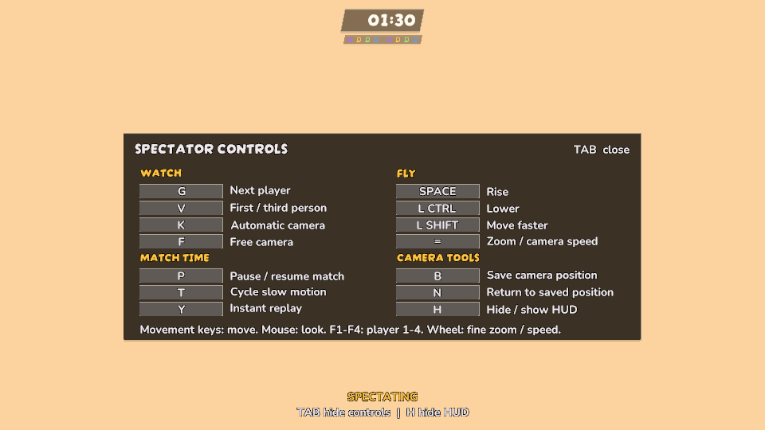

# Spectator refinement, 2026-10-25

## Controls and camera pacing

The desktop control list was one dense string rebuilt every frame. The new Tab
panel separates Watch, Fly, Match time and Camera tools, shows current bindings,
and keeps a small restore hint and view-mode label outside the panel. Key-name
formatting keeps long modifier names inside their boxes. Binding labels refresh
when the device or binding revision changes.

Desktop defaults add Space/right trigger for upward flight, T/Select to cycle
match speed and equals/right-stick press to cycle framing/fly speed. Recall moves
from gamepad down to B, separating it from Hide HUD. Tactical pause no longer
shares upward flight. Existing actions and other binding IDs/order are preserved.
Pause, replay and bookmarks work without an attached keyboard; shared watching
controls participate in rebind conflict checks. Camera commands observe the same
permission/state transitions.

Automatic shots normally retain their view for 4.5 seconds, with a settling
exception for a new ultimate and immediate handback for a missing subject. Camera
movement, aim and drift are gentler; an elapsed timer alone no longer flips the
shot to the other side. Camera height and fallback height move with the court's
elevation. Manual framing takes over from the automatic director.

Native desktop control render:

## Evidence

- Initial native body/scenery/transit baseline: 19/19 passed.
- Native geometry including elevated-court/fallback regression: 21/21 passed,
  `Logs/spectator-1025/geometry-edit.xml`.
- Native binding/context and director tuning: 12/12 passed,
  `Logs/spectator-1025/bindings-edit.xml`.
- Latest desktop controls, gamepad and event-pacing pass: 15/15 passed,
  `Logs/spectator-1025/desktop-final.xml`. Includes keyboardless pause/resume,
  saved-position recall, help visibility and delayed contact-event handover.
- Final gamepad/broadcast/manual-framing pass: 11/11 passed,
  `Logs/spectator-1025/desktop-controls-final.xml`. Pause indication follows the
  accepted match clock; manual framing releases the automatic director.
- Native UI was inspected at 960x540 and 1600x680. These are layout fixtures,
  not evidence that every map/kit or an actual networked observer is qualified.

## Remaining spectator scope

Actual player eye/look/FOV and first-person presentation, body-size-aware framing,
distinct skill/projectile/persistent-effect coverage, and the full current-map
matrix remain in progress under SPECTATOR-1025. The old body-yaw/operator-pitch
POV is not called an exact player view by this report. Real-peer view delivery,
target replacement, pause, role/round and reconnect need their own evidence.

The owner explicitly put a thorough mobile refresh **after NETWORKFIX**. The
experimental expanded touch strip was restored to its previous implementation;
this unit does not publish a new mobile UI. Future unrelated work is not required
to perform a mobile update automatically.
